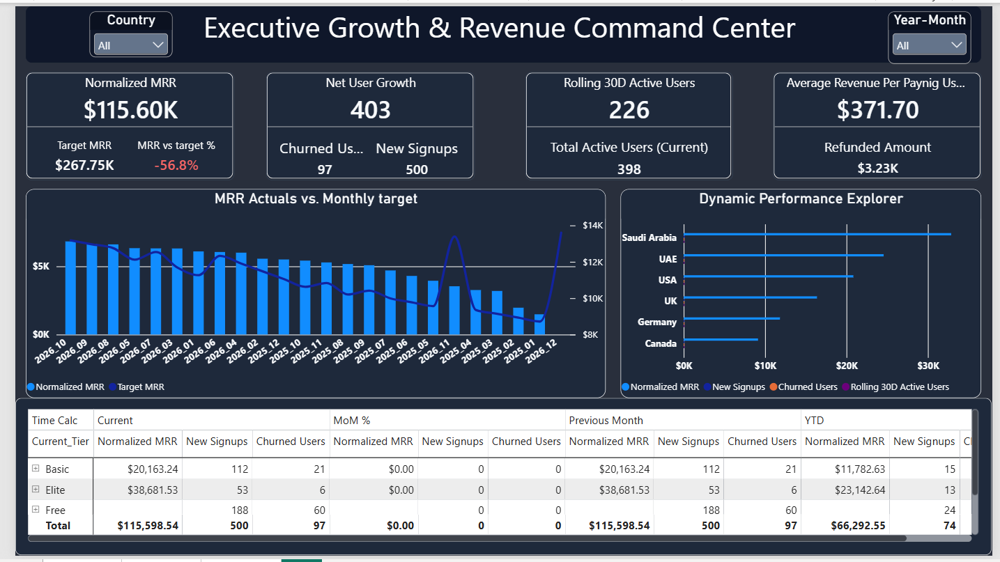
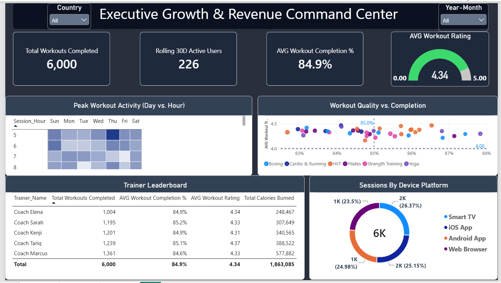
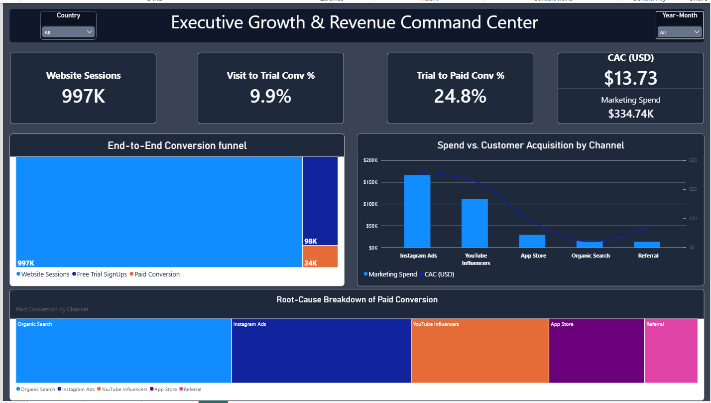
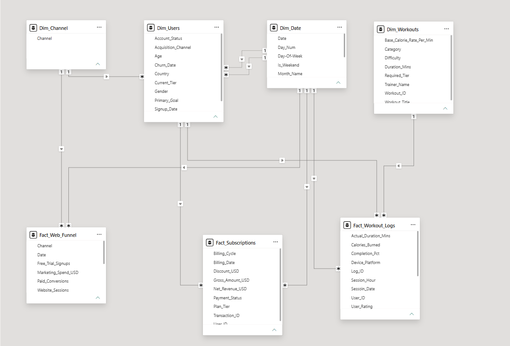

# B2C Fitness SaaS Growth & Revenue Command Center (Power BI)

An end-to-end Business Intelligence solution for a global B2C Fitness & Wellness SaaS platform, engineered to normalize multi-currency subscription revenue, track user engagement cohorts, evaluate customer acquisition efficiency (CAC), and benchmark actual performance against monthly targets.

## Dashboard Preview

### 1. Executive Revenue & Subscription Growth

### 2. User Engagement & Retention Analytics

### 3. Marketing Funnel & Acquisition Efficiency (CAC)

### 4. Star Schema Data Model

## Data Modeling & Technical Architecture
- **Multi-Currency Revenue Normalization:** Standardized international subscription transactions into USD using dynamic exchange-rate logic in Power Query / DAX.
- **Star Schema & Role-Playing Dates:** Modeled a conformed `Dim_Date` calendar supporting subscription start dates, churn dates, and daily workout activity without ambiguous relationship loops.
- **Calculation Groups:** Built reusable Time Intelligence calculation items (`Actual`, `MoM %`, `YoY %`, `YTD`) to eliminate measure bloat across revenue, subscriber, and engagement KPIs.
- **Disconnected Target Bridging:** Used multi-column `TREATAS()` to compare normalized Monthly Recurring Revenue (MRR) and new subscriber volume against disconnected planning targets.
- **Field Parameters:** Enabled dynamic switching across key SaaS metrics and demographic/tier dimensions (`Free`, `Pro`, `Elite`) directly on report visuals.

## Key Analytical Insights
- **Recurring Revenue & Plan Mix:** Tracked MRR growth across subscription tiers and regions, isolating upgrade velocity from `Pro` to `Elite` plans.
- **Engagement-to-Retention Correlation:** Identified workout frequency thresholds and streak milestones that strongly correlate with 90-day subscriber retention.
- **Acquisition Channel ROI:** Compared Customer Acquisition Cost (CAC) and conversion rates across paid social, organic search, and influencer channels against monthly budget targets.
